<div align="center">
  
</div>

<div align="center">

<a href="https://github.com/quietdom?tab=followers"></a>


**16 · self-taught · shipping anyway**

</div>

---

## `$ whoami`

```yaml
quietdom_:
  age: 16
  focus: coding agents, offensive security, firmware
  stack: python · typescript · c++ · c# · react · node
  currently: teaching agents to do the boring parts
  status: probably debugging something
```

## `$ ls ~/projects`

| project | what it is | stack |
| :--- | :--- | :--- |
| **[bruce-arsenal](https://github.com/quietdom/bruce-arsenal)**  | tools and payloads for Bruce firmware | C++ |
| **[agent-sdk](https://github.com/quietdom/agent-sdk)** | one API for Claude Code, Codex, Cursor, OpenCode | TypeScript |
| **[cybersecurity-dashboard](https://github.com/quietdom/cybersecurity-dashboard)** | footprint analysis and security overview | JavaScript |
| **[phantom-firmware](https://github.com/quietdom/phantom-firmware)** | ESP32-S3 pentest platform for the T-Embed | C++ |
| **[modelklub](https://github.com/quietdom/modelklub)** | OpenAI-compatible AI gateway on Cloudflare Workers | TypeScript |
| **[riff](https://github.com/rootscripts/riff)** | desktop music player — I ship features upstream | JavaScript |

## `$ git log --stats`

<p align="center">
  
  
</p>

<p align="center">
  
</p>

## `$ which`

**languages**

      

**tools**

      

---

<p align="center">
  <i>everything leaks eventually</i>
</p>

<p align="center">
  <sub>built between midnight and 3am · <a href="https://github.com/quietdom">github.com/quietdom</a></sub>
</p>
