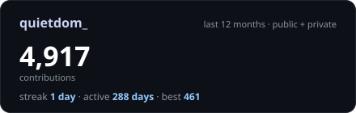

# quietdom_

16 · agents · security · firmware

everything leaks eventually

## building

**[bruce-arsenal](https://github.com/quietdom/bruce-arsenal)** — tools for Bruce firmware  
**[cybersecurity-dashboard](https://github.com/quietdom/cybersecurity-dashboard)** — footprint analysis and security overview  
**[riff](https://github.com/rootscripts/riff)** — desktop music player, contributing upstream

## stack

`python` `typescript` `c++` `c#` `react` `node` `docker` `linux`

---

